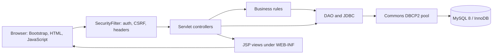
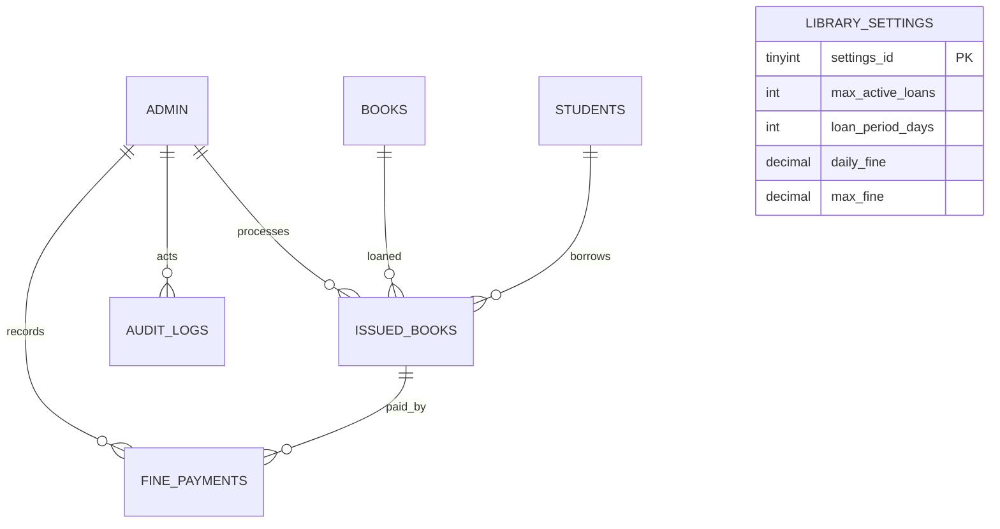

# Library Management System

A Java 17 library administration web application built on the existing JSP, Servlet, JDBC, and MySQL project. It packages as a WAR for Apache Tomcat 9 and keeps business rules and persistence in Java DAOs and services.

## Features

- Admin sign-in with BCrypt password hashes, session ID rotation, 30-minute idle timeout, temporary in-process sign-in throttling, profile display, and password change.
- Authentication filter for application routes, CSRF tokens for state-changing requests, UTF-8 request handling, baseline security headers, and JSP views protected under `WEB-INF`.
- Book CRUD with ISBN-10/ISBN-13 checksum validation, search, category and availability filters, allowlisted sorting, 20-row server-side pagination, and database-backed low-stock views.
- Inventory counts derived on creation and updated transactionally on edits. Reducing total copies below currently issued copies is rejected.
- Student CRUD and search with unique registration numbers, server-side field checks, soft deactivation, pagination, and a profile with up to 200 recent loans and fine balances.
- Book issue and return with row locks, active-student checks, duplicate-active-loan checks, a configurable per-student limit and loan period, and audit entries.
- Configurable per-day and maximum fines, partial or full fine payments using `DECIMAL`/`BigDecimal`, payment history, balance checks, and payment CSV export.
- Database-backed dashboard totals, overdue counts, outstanding fines, low-stock titles, recent circulation, and date-range reports for popular books, borrowers, overdue loans, inventory, fine collection, and monthly issue/return totals.
- CSV exports quote values and prefix formula-leading text to reduce spreadsheet formula injection.
- Bounded Apache Commons DBCP2 connection pool, environment/local configuration, SLF4J with Logback, and JUnit 5 unit tests for fine and ISBN rules and sign-in throttling.

## Architecture



The servlets validate HTTP input and select views. DAOs own prepared SQL and transaction boundaries. `FinePolicy` and `IsbnValidator` hold small pure business rules. JSP output uses `HtmlUtil.escape` for dynamic text; JSPs do not execute SQL.

## Data model



`books.available_copies` is maintained transactionally and constrained to not exceed `total_copies`. Loan history references books and students with `ON DELETE RESTRICT`; students are deactivated instead of removed. Assessed fines are stored on the loan and payments are separate immutable history rows.

## Requirements

- Java 17 JDK
- Maven 3.8+
- MySQL 8.0.16+ (for enforced `CHECK` constraints)
- Apache Tomcat 9.0.x
- VS Code users: Extension Pack for Java and a Tomcat server connector

The application uses `javax.servlet` and JSTL 1.2, so it is intended for Tomcat 9. It is not a Jakarta/Tomcat 10 application.

## Database setup

For a new local database, create the schema:

```bash
mysql -u root -p < database/schema.sql
```

In PowerShell, the equivalent is:

```powershell
Get-Content -Raw database/schema.sql | mysql -u root -p
```

Optional local sample catalog and demo students can be loaded with `mysql -u root -p library_management_system < database/seed.sql` (PowerShell: `Get-Content -Raw database/seed.sql | mysql -u root -p library_management_system`). The seed script does not create login accounts.

Create a restricted application account after the schema exists. Replace the example password with a secret from your local secret manager:

```sql
CREATE USER 'library_app'@'localhost' IDENTIFIED BY 'replace-this-local-secret';
GRANT SELECT, INSERT, UPDATE, DELETE ON library_management_system.* TO 'library_app'@'localhost';
```

Configure the app using either a full JDBC URL or the host settings:

```text
DB_URL=jdbc:mysql://127.0.0.1:3306/library_management_system?serverTimezone=UTC&useSSL=false&allowPublicKeyRetrieval=true
DB_USER=library_app
DB_PASSWORD=your-local-password
```

Alternatively, use `DB_HOST`, `DB_PORT`, and `DB_NAME` instead of `DB_URL`. `DB_URL` takes precedence when both forms are present. Copy `src/main/resources/db.properties.example` to `src/main/resources/db.properties` for local development. The local file is ignored by Git. The pool can be sized with `DB_POOL_MAX_TOTAL`, `DB_POOL_MAX_IDLE`, and `DB_POOL_MIN_IDLE`.

The host-based URL prefers TLS when the MySQL server supports it. For an external database provider, follow its TLS instructions and set a complete `DB_URL` if it requires a specific SSL mode or certificate.

Create the first admin interactively so the password is entered without echo and stored as a BCrypt hash. Run from a terminal that supports `System.console()` after configuring database credentials:

```bash
mvn -Dexec.mainClass=util.AdminBootstrap -Dexec.classpathScope=runtime org.codehaus.mojo:exec-maven-plugin:3.5.0:java
```

There is no default admin login. After an old-schema migration, this command can reset an inactive legacy admin by reusing its username, or create a new username when no active admin exists.

### Existing database upgrade

Back up the database first. On the original project schema, run `database/migrations/001_secure_circulation_upgrade.sql` exactly once, then run `database/schema.sql` to create settings, payment, and audit tables. The migration intentionally discards the old plaintext admin password column and disables the legacy admin rows. Use `AdminBootstrap` to set a new BCrypt credential. Do not run the one-time migration more than once.

## Build, test, and deploy

Run from the repository root:

```bash
mvn clean test
mvn package
```

The WAR is written to `target/library-management-system.war`. Copy it to Tomcat 9's `webapps` directory, start Tomcat, and open:

```text
http://localhost:8080/library-management-system/
```

For a root deployment, rename the WAR to `ROOT.war` and open `http://localhost:8080/`.

### VS Code with Tomcat 9

1. Install JDK 17, Maven, the Extension Pack for Java, and a Tomcat server extension.
2. Open this project folder and confirm the Java runtime is 17.
3. Run `mvn clean package` in the integrated terminal.
4. Add the Tomcat 9 installation in the Servers view and deploy `target/library-management-system.war`.
5. Set `DB_URL`, `DB_USER`, and `DB_PASSWORD` in the Tomcat launch configuration, then start the server.
6. Browse to the context URL above and sign in with the admin account created by `AdminBootstrap`.

Tomcat deployment must receive the DB environment variables itself; setting them only in a separate shell does not automatically configure a Windows service.

### Render: public web service and persistent MySQL

`render.yaml` provisions the application and its database together:

- A Java 17 / Tomcat 9 Docker web service, configured to listen on Render's `PORT` (default `10000`).
- A private MySQL 8.4 service with a persistent 10 GB disk mounted at `/var/lib/mysql`.
- The database schema is loaded on the first initialization. Render generates the MySQL passwords and passes the app username/password and private host to the web service; no credentials are stored in this repository.

To deploy:

1. Push this repository to GitHub's `main` branch.
2. In the Render Dashboard, choose **New > Blueprint**, connect GitHub if prompted, and select `Paritosh-Nilmani/Library_Management_System` on branch `main`. Render reads `render.yaml`.
3. Review the two services and the charges before applying. The Blueprint selects a paid `0.5c-512mb` plan for the web and private MySQL services, plus a 10 GB persistent disk. Render requires a paid service for persistent disks. Check current pricing in your account before continuing.
4. Apply the Blueprint and wait until both services are live. Check the MySQL service logs for successful first-time initialization.
5. In the web service's **Shell**, create the first administrator. Run:

   ~~~sh
   cd /usr/local/tomcat/webapps/ROOT
   java -cp "WEB-INF/classes:WEB-INF/lib/*" util.AdminBootstrap
   ~~~

   Follow the prompts. The password is entered without echo and stored as a BCrypt hash. There is no default admin account.
6. Open the web service page in Render and use the `onrender.com` URL shown there. Sign in with the administrator account you just created.

The database initialization script runs only when MySQL's data directory is empty. Keep the disk attached across deploys. Back up with `mysqldump` before schema changes; do not delete the database disk to rerun initialization. Render's MySQL deployment notes also recommend database-native backups instead of relying on disk snapshots.

Render references: [Docker deployments](https://render.com/docs/docker), [MySQL deployment](https://render.com/docs/deploy-mysql), [persistent disks](https://render.com/docs/disks), and [environment variables and secrets](https://render.com/docs/configure-environment-variables).
## Tests

`mvn clean test` runs JUnit 5 unit tests for ISBN validation, capped overdue fine calculation, and login throttling. The project does not yet include MySQL integration tests or end-to-end servlet tests. No destructive test data is loaded into the configured library database.

## Screenshots

Screenshots have not been captured yet. Add verified screenshots here after running the app against a local MySQL database.

## Project structure

```text
database/
  schema.sql
  migrations/
src/main/java/
  dao/       JDBC queries and transaction operations
  filter/    Authentication and CSRF security filter
  model/     Admin, book, student, loan, payment, report, and settings data
  service/   Fine and ISBN rules
  servlet/   MVC controllers
  util/      Connection pool, bootstrap, and login throttling
src/main/resources/
  db.properties.example
src/main/webapp/
  WEB-INF/jsp/
  WEB-INF/web.xml
  css/
src/test/java/
  service/
  util/
```

## Troubleshooting

- **Database connection refused:** Check MySQL is running, the port in `DB_URL` is correct, and the JDBC URL uses the intended database.
- **Access denied:** Confirm the `library_app` username/password and its grants. Environment variables must be visible to the Tomcat process.
- **Unknown column/table after updating:** Apply the one-time migration to the original schema, then rerun `database/schema.sql` to create new tables.
- **Port 8080 is busy:** Change Tomcat's HTTP connector port or stop the other process using it.
- **WAR fails to deploy:** Verify Tomcat 9 (not Tomcat 10), Java 17, `javax.servlet` APIs, and the Tomcat logs under `logs/`.
- **Admin sign-in fails:** Create or reset the initial active admin using `AdminBootstrap`; the project does not ship a default password.

## Known limitations

- The sign-in throttle is process-local. A multi-instance deployment needs a shared rate-limit store.
- Role values are stored, but librarian-specific route authorization and admin user management are not implemented; all authenticated accounts currently receive the same application access.
- Lost/damaged status values are represented in the schema and filters, but there is no workflow to mark a loan lost or damaged.
- MySQL integration tests, servlet tests, exhaustive accessibility review, and a live Tomcat/MySQL deployment check remain to be added.
- Some inherited JSPs still use Java scriptlets for rendering. All moved JSPs are under `WEB-INF`, and output values are escaped, but converting every view to JSTL/EL is a follow-up cleanup.
- CDN-hosted Bootstrap assets require internet access in the browser; self-host the assets for an offline deployment.

## Suggested repository metadata

**Description:** Java 17 library administration portal built with JSP, Servlets, JDBC, MySQL, and Tomcat 9, featuring secure admin access, transactional circulation, inventory, fines, reports, and CSV exports.

**Topics:** `java`, `servlets`, `jsp`, `jdbc`, `mysql`, `tomcat`, `maven`, `library-management`, `mvc`, `connection-pooling`
